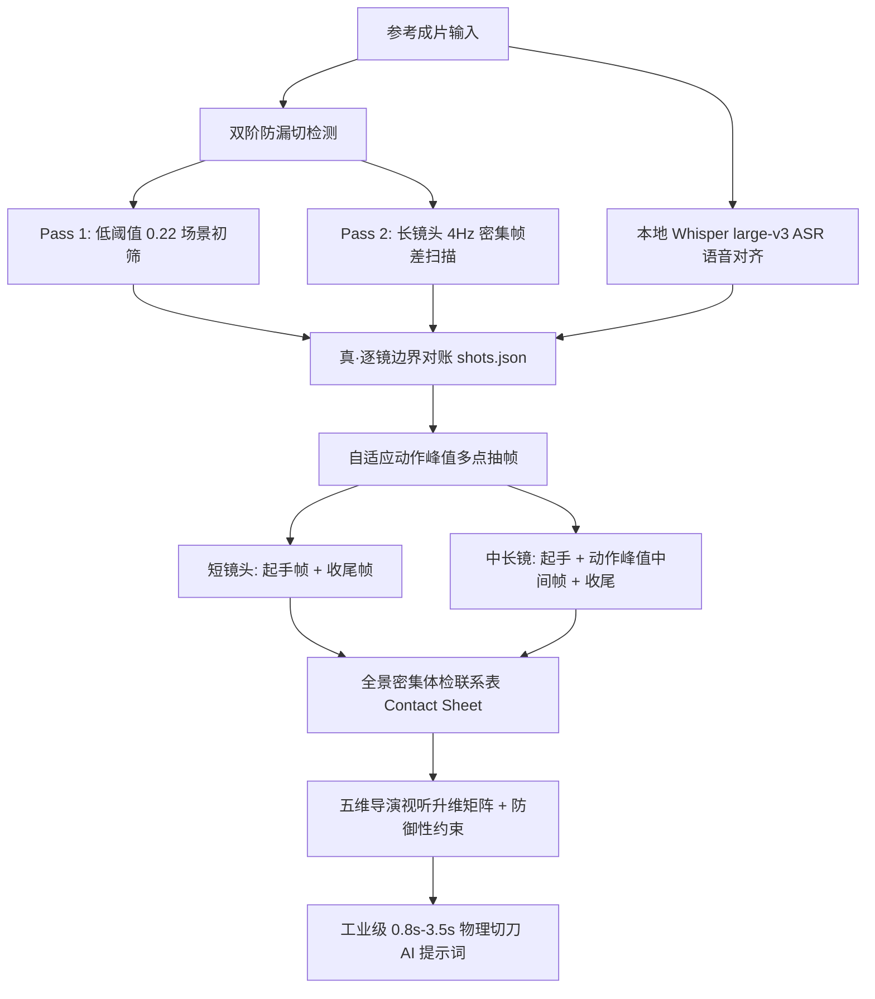

# 🎬 video-replicate (导演级高精拉片与AI视频复刻引擎)

> **从任意参考成片，零漏切、零画面盲区拆解逐镜分镜表，结合本地 Whisper large-v3 ASR 毫秒级语音对齐，一键升维生成具备电影几何构图、群演舞台调度、微表情权力反转与【防御性防错约束】的工业级 AI 视频提示词。**
> 
> 专为 **即梦 Seedance 2.5 / 可灵 Kling 1.5/2.0 / 跑道 Runway / 混元** 等前沿多模态 AI 视频模型打造。完美兼容 **Codex / Claude Code / Antigravity / Cursor**。

---

## 💡 为什么需要这个项目？

在日常使用 AI 视频模型复刻爆款短视频或短剧时，创作者普遍面临四大致命痛点：

1. **传统自动拉片工具严重“漏刀并镜”**：
   大部分现有开源工具仅使用单一高阈值（如 `scene > 0.3`）做粗糙的色彩突变检测。遇到短视频中密集的**同色调正反打**、**同光影跳切**或**室内连续镜头**时，算法直接判定“画面未动”，强行把 3~5 个截然不同的独立镜头合并成一个长达 8~10 秒的长镜头，导致关键镜头大面积蒸发！
2. **传统抽帧规则存在巨大的“中间帧黑洞”**：
   传统脚本往往死板地只抽 15% 与 85% 两张图。一旦镜头被错误合并，15%~85% 之间发生的**人物震惊大特写、微表情反转、起锅装盘、推门转场与关键台词画面**，在 AI 视野中直接变成了无法被观测的盲区！
3. **单镜头时段过长导致 AI 动作崩塌与抽搐**：
   在 Seedance 2.5 中，若单个提示词时段长达 5~8 秒，模型极易产生**动作停滞（呆立晃动）、肢体融化畸变、随机镜头乱晃**，甚至把后半段动作直接吃掉！必须将镜头切细至 **0.8s ~ 3.5s 黄金控制区间**。
4. **提示词缺少“防御性防错约束”（Defensive Prompting）**：
   很多创作者写出的提示词只是简单平铺剧情，AI 极易在生成时发生“抢口型（背景人物抢主角台词）”、“道具上下文污染（把上一场景的碗画成手机）”、“物体穿模碰撞”等低级错误。

**`video-replicate` 正是为了彻底消灭这四大硬伤而生。**

---

## 🚀 核心架构与独家技术方案



### 1. 双阶多轨防漏切检测 (Dual-Pass Cut Detection)
* **初筛轨**：采用 0.22 敏感阈值进行全片切片，大幅降低漏检率；
* **体检轨**：内置 `audit` 诊断器，对所有时长大于 2.2 秒的片段自动启动 4Hz 微观帧差对账，自动揪出隐藏在内部的跳切与正反打。

### 2. 动作峰值自适应多点采样 (Adaptive Multi-Point Keyframing)
* 告别死板的 15%/85% 首尾抽帧；
* 镜头时长 >1.5s 强制在 50% 核心动作区截取**动作峰值帧（Action Peak）**；
* 镜头时长 >3.5s 自动扩展为 4 点采样，彻底封堵任何微表情与转场的遗漏。

### 3. 本地 Whisper large-v3 ASR 毫秒级语音对齐
* 集成 `scripts/transcribe.py`，支持调用本地 Faster-Whisper large-v3 离线模型；
* 输出带词级时间戳（Word-timestamps）的对白转写，严格标定画外音（V.O.）与同期声（Sync Sound）。

### 4. 0.8s ~ 3.5s 极限微观切刀与防御性提示词 (Defensive Prompting)
* **物理切刀 1:1 对齐**：如 0.66s 倒生抽、0.94s 锅内翻炒均独立成镜，模型执行确定性接近 100%；
* **防御性结界**：
  * 🔒 *防道具混淆*：“他们举的是空碗，不是手机”；“粉丝举的是手机，不变成空碗”；
  * 🔒 *防抢对白口型*：“父亲背对摄影机不抢口型”；“画外音传来，父亲只做震惊表情，绝不说话”；
  * 🔒 *防穿模碰撞*：“剪刀始终只碰头发，不碰耳朵”；“跑车与老人有明确安全距离，没有碰撞”；
  * 🔒 *防剧情幻觉*：“严禁捡到古董或彩票，荒诞笑点源于剧情跳跃”。

---

## 🛠️ 快速上手 (Quick Start)

### 常用命令工作流

```bash
# 1. 执行双阶防漏切检测，生成初始分镜表
node scripts/video-replicate.mjs seed "path/to/video.mp4" --out shots.json --title "片名"

# 2. 调用本地 Whisper large-v3 跑音频转写与台词对齐
python scripts/transcribe.py "path/to/video.mp4" transcript-asr.json

# 3. 一键体检潜在漏刀长镜头（自动筛查 >2.5s 的长镜头）
node scripts/video-replicate.mjs audit shots.json --thresh 2.5

# 4. 执行自适应多点抽帧（起手 + 动作峰值 + 收尾）
node scripts/video-replicate.mjs frames shots.json --video "path/to/video.mp4" --dir frames

# 5. 生成全景密集体检大图（单张大图核对全片动作流）
node scripts/video-replicate.mjs sheet --dir frames --out sheets --cols 6 --rows 6

# 6. 精准补刀（若长镜头内发现漏刀，精准在时间戳补切）
node scripts/video-replicate.mjs recut shots.json --split 17.5 --split 19.0
```

---

## 📂 项目结构

```
video-replicate/
├── README.md                          # 官方详细使用指南与教学文档
├── SKILL.md                           # 兼容 Codex / Antigravity / Claude Code / Cursor 的标准技能规范
├── package.json                       # 开源工程元数据
├── scripts/
│   ├── video-replicate.mjs            # 核心 Node.js 双阶切点与自适应采样引擎
│   └── transcribe.py                  # 本地 Whisper large-v3 ASR 词级时间戳对齐引擎
├── references/
│   └── directorial-framing.md         # 独家：电影级视听几何学与微表情 Prompt 词表指南
└── examples/
    └── 忆苦思甜-4段高精提示词/           # 实战典范：102.35s 完整覆盖（30s+30s+30s+13s）极限微观防御性提示词
        ├── 01-30秒提示词.txt
        ├── 02-30秒提示词.txt
        ├── 03-30秒提示词.txt
        └── 04-结尾13秒提示词.txt
```

---

## 📄 开源许可 (License)

本项目采用 [Apache-2.0 License](./LICENSE) 开源许可，欢迎广大 AI 视频创作者、影视导演与开发者自由使用、二开与交流。
