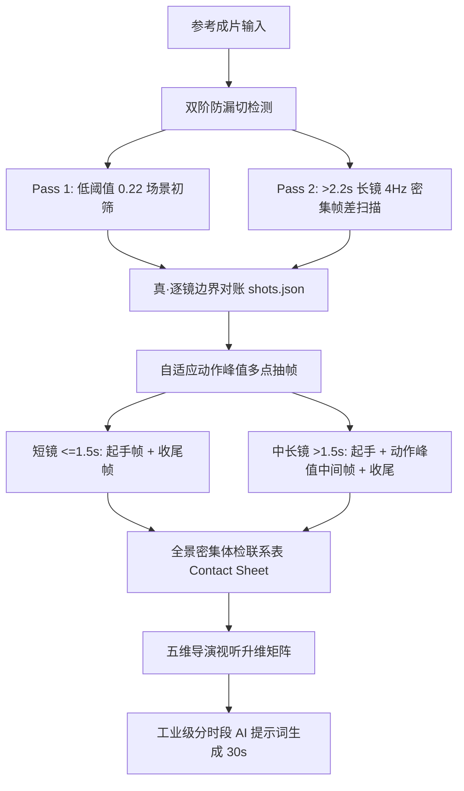

# 🎬 video-replicate (导演级高精拉片与AI视频复刻引擎)

> **从任意参考成片，零漏切、零画面盲区拆解逐镜分镜表，一键升维生成具备电影几何构图、群演舞台调度与微表情权力反转的工业级 AI 视频提示词。**
> 
> 专为 **即梦 Seedance 2.5 / 可灵 Kling 1.5/2.0 / 跑道 Runway / 混元** 等前沿多模态 AI 视频模型打造。

---

## 💡 为什么需要这个项目？

在日常使用 AI 视频模型复刻爆款短视频或短剧时，创作者普遍面临三大致命痛点：

1. **传统自动拉片工具严重“漏刀并镜”**：
   大部分现有开源工具仅使用单一高阈值（如 `scene > 0.3`）做粗糙的色彩突变检测。遇到短视频中密集的**同色调正反打**、**同光影跳切**或**室内连续镜头**时，算法直接判定“画面未动”，强行把 3~5 个截然不同的独立镜头合并成一个长达 8~10 秒的长镜头，导致关键镜头大面积蒸发！
2. **传统抽帧规则存在巨大的“中间帧黑洞”**：
   传统脚本往往写死每镜只抽 15% 与 85% 两张图。一旦镜头被错误合并，15%~85% 之间发生的**人物震惊大特写、微表情反转、起锅装盘、推门转场与关键台词画面**，在 AI 视野中直接变成了无法被观测的盲区！
3. **提示词沦为平庸的“电视剧小品流水账”**：
   很多创作者写出的提示词只是简单平铺剧情（如“一个男人走过来，跟女人说话”），导致 AI 随机生成廉价的平视腰平中景。爆款视频的灵魂在于**构图几何学（一点透视灭点、树洞隧道）、空间图层（隔玻璃内外撕裂、暗调剪影过肩OTS）、群演舞台调度（金字塔抱团、宗教式朝拜举碗）与微表情权力对撞（降窗挑墨镜）**，这些导演思维必须被精确翻译为模型可理解的电影摄影语言。

**`video-replicate` 正是为了彻底消灭这三大硬伤而生。**

---

## 🚀 核心架构与独家技术方案



### 1. 双阶多轨防漏切检测 (Dual-Pass Cut Detection)
* **初筛轨**：采用 0.22 敏感阈值进行全片切片，大幅降低漏检率；
* **体检轨**：内置 `audit` 诊断器，对所有时长大于 2.2 秒的片段自动启动 4Hz 微观帧差对账，自动揪出隐藏在内部的跳切与正反打。

### 2. 动作峰值自适应多点采样 (Adaptive Multi-Point Keyframing)
* 告别死板的 15%/85% 首尾抽帧；
* 镜头时长 >1.5s 强制在 50% 核心动作区截取**动作峰值帧（Action Peak）**；
* 镜头时长 >3.5s 自动扩展为 4 点采样，彻底封堵任何微表情与转场的遗漏。

### 3. 五维导演视听升维矩阵 (Directorial Framing Matrix)
将原本单薄的画面描述升级为电影工业级摄影语言：
* **几何透视**：韦斯·安德森式一点透视居中（One-Point Perspective）、树洞长廊深远纵深、镜面正对反射视点；
* **空间图层**：隔玻璃落地窗双层反光撕裂、暗调黑色人物侧背影剪影过肩（OTS）、贴地 5 厘米超低机位公路极速；
* **群演舞台调度**：5 人金字塔紧凑抱团聚焦、全场信徒式高举白瓷空碗朝拜；
* **微表情权力反转**：防窥车窗缓降、食指勾下墨镜、眼神轻蔑上挑、瞳孔地震跳切大特写；
* **声画关系解耦**：严格隔离同期声对嘴与画外音旁白（V.O.），杜绝 AI 乱对口型。

---

## 🛠️ 快速上手 (Quick Start)

### 环境依赖
* **Node.js** >= 18.0.0（纯标准库，**零 npm 安装依赖**）
* **FFmpeg / FFprobe**（已配置在系统环境变量 `PATH` 中）

### 常用命令工作流

```bash
# 1. 执行双阶防漏切检测，生成初始分镜表
node scripts/video-replicate.mjs seed "path/to/video.mp4" --out shots.json --title "片名"

# 2. 一键体检潜在漏刀长镜头（自动筛查 >2.5s 的长镜头）
node scripts/video-replicate.mjs audit shots.json --thresh 2.5

# 3. 执行自适应多点抽帧（起手 + 动作峰值 + 收尾）
node scripts/video-replicate.mjs frames shots.json --video "path/to/video.mp4" --dir frames

# 4. 生成全景密集体检大图（单张大图核对全片动作流）
node scripts/video-replicate.mjs sheet --dir frames --out sheets --cols 6 --rows 6

# 5. 精准补刀（若长镜头内发现漏刀，精准在时间戳补切）
node scripts/video-replicate.mjs recut shots.json --split 17.5 --split 19.0
```

---

## 📋 交付标准：工业级 AI 提示词规范 (30s 档位)

生成的提示词直接适配 **即梦 Seedance 2.5** 等多模态引擎：

```markdown
电影级质感，2.35:1宽银幕，4K高清画质，冷暖电影光影，高度张力与荒诞喜剧风格。全程纯净镜头画面，严禁生成任何假字幕或界面图标。

【角色锚定】
父亲：45岁中年男子，方脸浓眉，身穿深黑色修身长袖T恤。
林小柔：18岁少女，挑染粉发双马尾，精致白皙面容，粉色系休闲装。

【分时段摄影与导演调度】
- 0.0-3.5秒 [深焦走廊大步突入]：机位固定在高级餐厅后厨内，正对尽头狭长走廊与金属电梯门。广角深焦镜头。电梯门滑开，黑色衣服父亲严厉拽着林小柔大步向镜头前方走来。景深极大，父亲转头严厉训斥：“不好好读书，你就来体验一下生活的苦！”女儿满不在乎撇嘴。
- 3.5-7.5秒 [后厨大灶低角度翻炒]：商用大厨房不锈钢灶台侧前方，中景微仰拍。林小柔单手握住大铁锅把手，轻松自如单手大颠勺！巨大火苗瞬间从锅底冲天腾起，林小柔神色漫不经心甚至打哈欠。反打旁边专业厨师目瞪口呆。
- 16.5-24.0秒 [视觉神笔·一点透视居中大堂朝拜]：严格一点透视居中构图（One-Point Perspective）！左右两排长餐桌呈现完美的几何轴对称向中心深处延伸。画面两旁的数十名食客全部背对镜头，整齐划一将白瓷空碗双手高高举过头顶狂热摇晃朝拜！父亲孤零零站在中央走道正中心最深处的透视灭点上，被全场信徒般的求饭场景彻底吓瘫在原地。
```

---

## 📂 项目结构

```
video-replicate/
├── README.md                          # 官方中英详细使用指南与教学文档
├── SKILL.md                           # 兼容 Antigravity / Claude Code / Cursor 的标准技能规范
├── package.json                       # 开源工程元数据
├── scripts/
│   └── video-replicate.mjs            # 核心 Node.js 双阶切点与自适应采样引擎
└── references/
    └── directorial-framing.md         # 独家：电影级视听几何学与微表情 Prompt 词表指南
```

---

## 📄 开源许可 (License)

本项目采用 [Apache-2.0 License](./LICENSE) 开源许可，欢迎广大 AI 视频创作者、影视导演与开发者自由使用、二开与交流。
